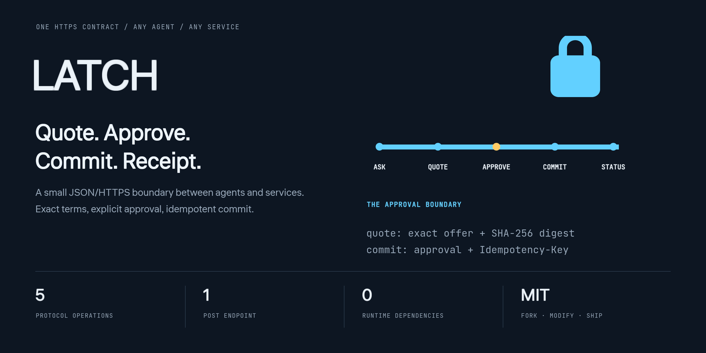
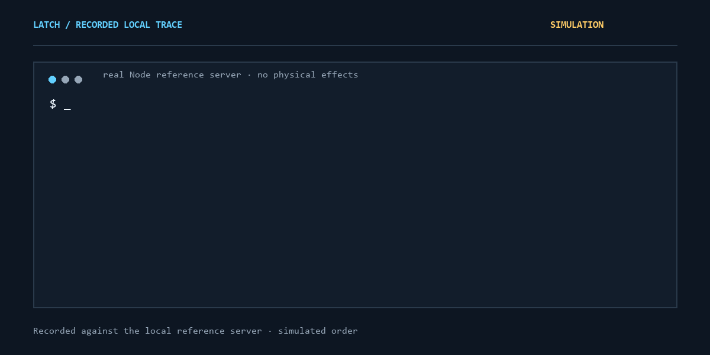
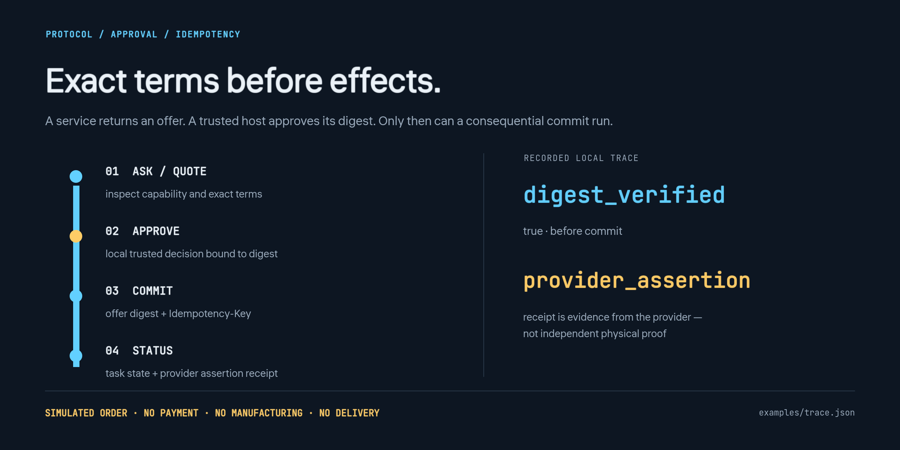

<div align="center">
  
  <p><strong>The connector between a customer's agent and a business service.</strong></p>
  <p>One card · one POST endpoint · five operations · no SDK required · MIT</p>
  <p>
    <a href="#run">Run</a> ·
    <a href="#connect-a-provider">Connect a provider</a> ·
    <a href="SPEC.md">Specification</a> ·
    <a href="#boundaries">Boundaries</a> ·
    <a href="https://balanov.pro/latch/">Live demo</a> ·
    <a href="README_RU.md">Русский</a>
  </p>
</div>

[](https://github.com/Balanov/latch/actions/workflows/ci.yml) [](https://github.com/Balanov/latch/releases/latest)

<div align="center">
  
  <p><sub>Six recorded steps against the real local Node reference server. The provider and outcome are simulations: no payment, manufacturing or delivery. <a href="examples/trace.json">Trace</a>.</sub></p>
</div>

LATCH does not replace MCP, A2A, OpenAPI, UCP/ACP/AP2, identity, or payment systems. It provides a small boundary:

```text
GET /.well-known/latch.json
ask     → read without consequential effects
quote   → exact offer + SHA-256 digest; no execution
approve → local trusted-host/user decision bound to that digest
commit  → offer digest + approval + Idempotency-Key
status  → task + provider_assertion receipt
```

- Node.js 20+ reference client/server/CLI, one ESM file, zero runtime dependencies.
- Optional single-writer persistent store and caller-scoped authentication.
- Optional MCP stdio bridge. HTTP alone is enough for other agents and languages.
- No registry, account, telemetry, hosted proxy, automatic installer, or payment rail.

> **Experimental wire version 0.1; implementation 0.2.0.** Demo orders are simulations: nothing is paid for, manufactured, or delivered.

<div align="center">
  
  <p><sub>Exact terms before effects. A digest binds content, not a person. A provider assertion is not independent physical evidence. <a href="SPEC.md">Protocol and security rules</a>.</sub></p>
</div>

**[Live Node ↔ PHP demo](https://balanov.pro/latch/) · [Specification](SPEC.md) · [MIT license](LICENSE)**

## Run

```sh
git clone https://github.com/Balanov/latch.git
cd latch
npm test
node latch.mjs demo --trace examples/trace.json
```

The trace records actual local discovery, ask, quote, approval, commit, and receipt messages, including full IDs and HTTP headers.

Start the provider and use another terminal:

```sh
node latch.mjs demo --port 8787
```

```sh
node latch.mjs discover http://127.0.0.1:8787
node latch.mjs ask http://127.0.0.1:8787 materials.list
node latch.mjs quote http://127.0.0.1:8787 print3d.order \
  '{"model_url":"https://example.com/model.stl","material":"pla","quantity":1,"delivery":{"country":"NL","postal_code":"1011"}}'
```

Review the terms, origin, expiry, and digest. Repeat the **exact** digest after `--yes`; a mismatch aborts before a connection:

```sh
node latch.mjs commit http://127.0.0.1:8787 off_YOUR_OFFER \
  --digest sha256-YOUR_REVIEWED_DIGEST \
  --yes sha256-YOUR_REVIEWED_DIGEST
node latch.mjs status http://127.0.0.1:8787 task_YOUR_TASK
```

Library users must reuse the same idempotency key when retrying the same commit.

## Connect a provider

```sh
npx --yes github:Balanov/latch init my-latch-service
cd my-latch-service
npm install
node service.mjs
```

Or use `createLatchServer(card, handlers, options)` and `listen(server, options)` from `latch-protocol`. A write capability needs separate `quote` and `commit` handlers:

- `quote` returns `summary`, `terms`, and expiry without performing the effect.
- `commit` performs it only after exact offer/approval validation and idempotency handling.
- The provider still owns authorization, complete schema validation, accurate terms, rate limits, and external effects.

A direct read needs no runtime:

```http
POST /latch
Content-Type: application/json

{"latch":"0.1","id":"req_1","op":"ask","capability":"materials.list","input":{}}
```

The other operations are `quote`, `commit`, `status`, and `cancel`. See [SPEC.md](SPEC.md) for canonical JSON, expiry, approval, replay, and security rules. The dependency-free validator supports a documented JSON Schema subset, not the full specification.

## Persistence and caller isolation

The default is in-memory. For restart-safe local use, add the single-writer file store and an explicit authentication verifier:

```js
import { createDemoProvider, createFileStore, listen } from "latch-protocol";

const server = createDemoProvider({
  store: createFileStore("./data/latch.json"),
  authenticate: async (request) => verifyRequest(request)
  // Your verifier returns a stable principal id or null.
});
await listen(server, { port: 8787 });
// On shutdown: await server.latch.close();
```

Offers, tasks, idempotency records, and pending commits are scoped by the returned principal. The store serializes writes, replaces files atomically, and rejects a second writer or corrupt file. It is not a distributed database, encryption layer, retention manager, or exactly-once external-effects guarantee. Implement the async `get`/`set` store adapter for a production database.

Client responses are size-limited while streaming. Timeouts return `504 timeout`. Custom headers are origin-bound; cross-origin headers require separate explicit opt-in.

## Independent PHP provider

`providers/php/` implements the simulated provider for PHP 8.2 without Composer. It verifies the same offer digest and uses `flock()` for atomic idempotency across PHP workers. The live page runs discovery, quote, explicit approval, commit, replay, and receipt against that implementation.

The public demo uses CORS `*` only because it has no credentials or real effects. Do not copy that policy to private or consequential services. Deployment and limitations: [providers/php/README.md](providers/php/README.md).

## Optional MCP bridge

```json
{
  "mcpServers": {
    "latch": {
      "command": "npx",
      "args": ["--yes", "github:Balanov/latch", "mcp"]
    }
  }
}
```

The host must show the actual offer and enforce approval before calling `latch_commit`. A tool call or `cli-explicit` claim is not verified human identity.

## Missing a provider?

```sh
node latch.mjs invite https://service.example
```

This prints reviewable text only. It does not contact the provider, post an issue, install code, or establish a connection. A person can send it through an existing channel; retry discovery after explicit integration.

## Benchmarks and checks

```sh
npm test
npm run bench
npm ci --prefix bench/competitors --ignore-scripts
npm run bench:compare
node test/browser-check.mjs
node test/public-provider-check.mjs # network required; also runnable manually in CI
```

- `BENCHMARKS.md`: intrinsic file size, cold start, and local full-flow measurements.
- `COMPARISONS.md`: four rotated rounds of equivalent read calls against official MCP SDK 1.32.2, with raw samples and environment.
- `test/browser-check.mjs`: live UI, approval invalidation, replay, receipt, clipboard, keyboard, exact 375/768/1024/1440px layouts, console/network failures. Set `CHROME_BIN` when needed.
- CI runs tests and both benchmark jobs on Node 20 and 24. The SDK is only a benchmark dev-dependency.

These are local measurements, not production latency or a universal protocol ranking. Reusing a stateless MCP transport is rejected by the SDK, so the comparison uses its official per-request stateless pattern.

## Boundaries

- A digest binds content, not a person, provider, or business claim.
- A `provider_assertion` receipt is not independent physical evidence.
- Idempotency cannot undo an external effect or promise exactly-once reality.
- Remote cards, descriptions, and results are untrusted data, not agent instructions.
- Default storage is in-memory and unauthenticated. Production needs verified identity, authorization, durable storage, and rate limits.
- The PHP demo never downloads models or performs real work.

See [SECURITY.md](SECURITY.md) and [docs/RESEARCH.md](docs/RESEARCH.md).

## Forks

MIT. No CLA. Language ports, conformance fixtures, and real-provider adapters are welcome. Run tests and benchmarks before a PR. Security reports follow `SECURITY.md`, not public issues.

## Cite

See [CITATION.cff](CITATION.cff).

```bibtex
@software{balanov2026latch,
  author = {Balanov, Anton},
  title = {LATCH: One Tiny HTTPS Contract Between Any Agent and Any Service},
  year = {2026},
  version = {0.2.0},
  license = {MIT},
  url = {https://github.com/Balanov/latch}
}
```
