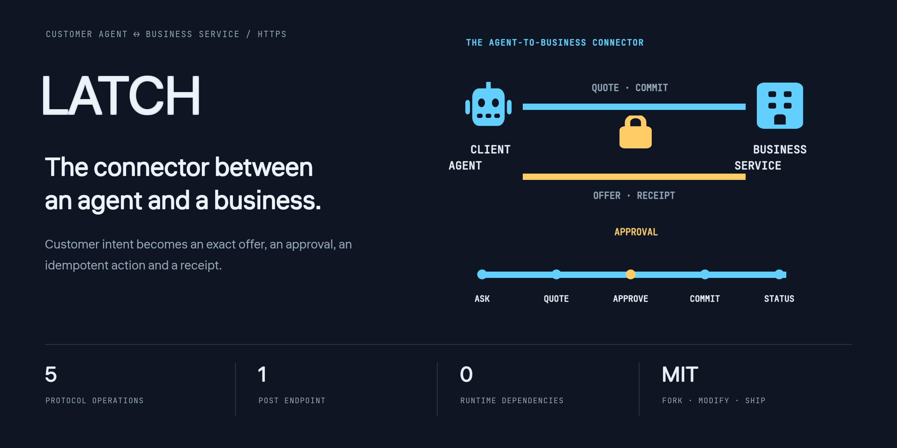
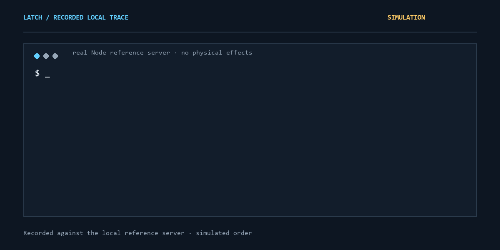
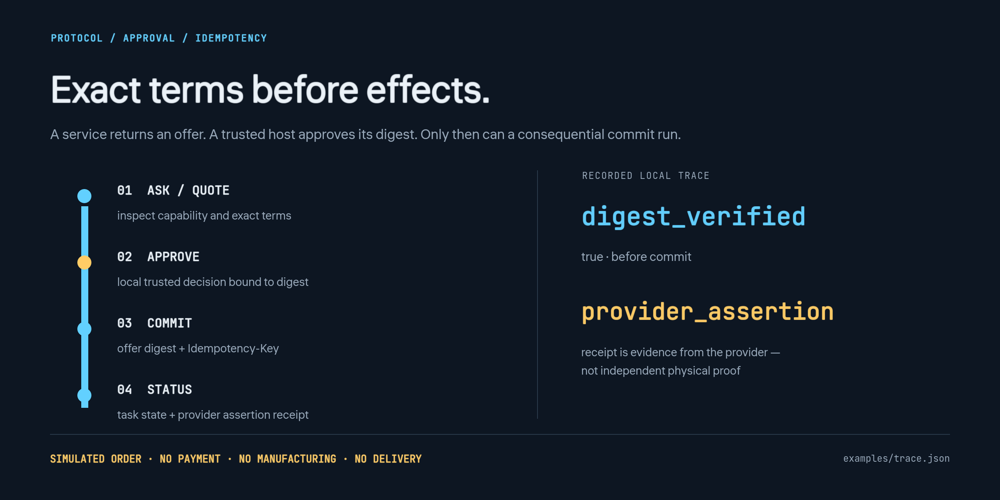

<div align="center">
  
  <p><strong>Коннектор между агентом клиента и сервисом бизнеса.</strong></p>
  <p>Одна карточка · один POST endpoint · пять операций · MIT</p>
  <p><a href="README.md">English</a> · <a href="#запуск">Запуск</a> · <a href="#граница-безопасности">Граница безопасности</a> · <a href="SPEC.md">Спецификация</a> · <a href="https://balanov.pro/latch/">Живое демо</a></p>
</div>

Краткое русское введение. Полная спецификация, клиентская библиотека, хранение, MCP bridge и ограничения — в [английском README](README.md).

## Что делает LATCH

LATCH задаёт небольшую границу между агентом и сервисом. Он не заменяет MCP, A2A, OpenAPI, UCP/ACP/AP2, identity или платёжные системы. Протокол отвечает только за понятный порядок действий:

```text
GET /.well-known/latch.json
ask     → чтение без consequential effects
quote   → точное предложение + SHA-256 digest; без выполнения
approve → локальное решение trusted-host/user, связанное с digest
commit  → digest предложения + approval + Idempotency-Key
status  → задача + provider_assertion receipt
```

Реализация на Node.js 20+: client/server/CLI в одном ESM-файле, ноль runtime-зависимостей. Есть необязательное single-writer persistent хранилище, caller-scoped аутентификация и MCP stdio bridge. Для других агентов и языков достаточно обычного HTTP.

> **Experimental wire 0.1; реализация 0.2.0.** Заказы в демо — симуляции: оплата, производство и доставка не выполняются.

<div align="center">
  
  <p><sub>Шесть записанных шагов против настоящего локального Node reference server. Симуляция, а не реальный заказ.</sub></p>
</div>

## Запуск

```sh
git clone https://github.com/Balanov/latch.git
cd latch
npm test
node latch.mjs demo --trace examples/trace.json
```

Trace содержит реальные локальные discovery, ask, quote, approval, commit и receipt с ID и HTTP-заголовками.

Запустите провайдера, затем откройте другой терминал:

```sh
node latch.mjs demo --port 8787
```

```sh
node latch.mjs discover http://127.0.0.1:8787
node latch.mjs ask http://127.0.0.1:8787 materials.list
node latch.mjs quote http://127.0.0.1:8787 print3d.order \
  '{"model_url":"https://example.com/model.stl","material":"pla","quantity":1,"delivery":{"country":"NL","postal_code":"1011"}}'
```

Проверьте условия, origin, срок действия и digest. Повторите **точный** digest после `--yes`; несовпадение останавливает выполнение до соединения:

```sh
node latch.mjs commit http://127.0.0.1:8787 off_YOUR_OFFER \
  --digest sha256-YOUR_REVIEWED_DIGEST \
  --yes sha256-YOUR_REVIEWED_DIGEST
node latch.mjs status http://127.0.0.1:8787 task_YOUR_TASK
```

При повторе того же commit в библиотеке необходимо использовать тот же idempotency key.

## Подключение сервиса

```sh
npx --yes github:Balanov/latch init my-latch-service
cd my-latch-service
npm install
node service.mjs
```

Для write capability нужны отдельные `quote` и `commit` handlers:

- `quote` возвращает `summary`, `terms` и срок действия, не выполняя эффект;
- `commit` выполняет действие только после проверки точного предложения, approval и idempotency.

Провайдер сам отвечает за авторизацию, полную проверку схемы, точные условия, rate limits и внешние эффекты.

Прямое чтение работает без SDK:

```http
POST /latch
Content-Type: application/json

{"latch":"0.1","id":"req_1","op":"ask","capability":"materials.list","input":{}}
```

Остальные операции: `quote`, `commit`, `status` и `cancel`. Правила canonical JSON, expiry, approval и replay — в [SPEC.md](SPEC.md).

## Граница безопасности

<div align="center">
  
</div>

- Digest связывает содержимое, а не человека, провайдера или бизнес-обещание.
- `provider_assertion` — утверждение провайдера, а не независимое физическое доказательство.
- Idempotency не отменяет уже произошедший внешний эффект и не обещает exactly-once реальность.
- Удалённые карточки, описания и результаты — недоверенные данные, а не инструкции агенту.
- Default storage — память без аутентификации. Для production нужны проверенная identity, авторизация, durable storage и rate limits.
- PHP-демо ничего не скачивает, не печатает и не производит.

Подробности: [SECURITY.md](SECURITY.md) и [docs/RESEARCH.md](docs/RESEARCH.md).

## Проверки

```sh
npm test
npm run bench
npm run bench:compare
node test/browser-check.mjs
```

- `BENCHMARKS.md`: размер, cold start и полный локальный поток.
- `COMPARISONS.md`: четыре чередующихся раунда read-вызовов против официального MCP SDK с сырыми образцами и окружением.
- CI запускает тесты и benchmarks на Node 20 и 24. Это локальные измерения, а не универсальный рейтинг протокола.

MIT. Без CLA. Независимые реализации, conformance fixtures и адаптеры реальных провайдеров приветствуются. [LICENSE](LICENSE) · [CITATION.cff](CITATION.cff)
